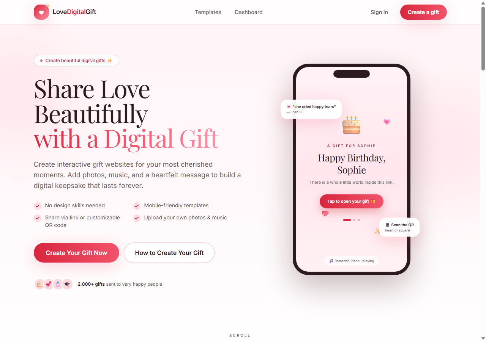
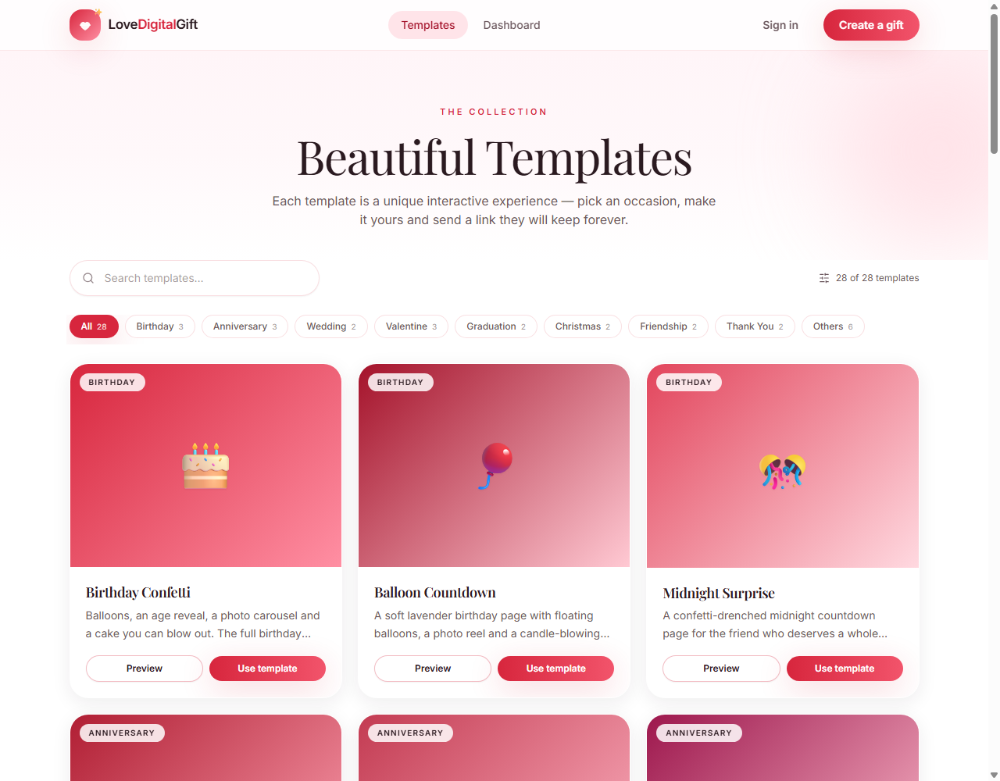
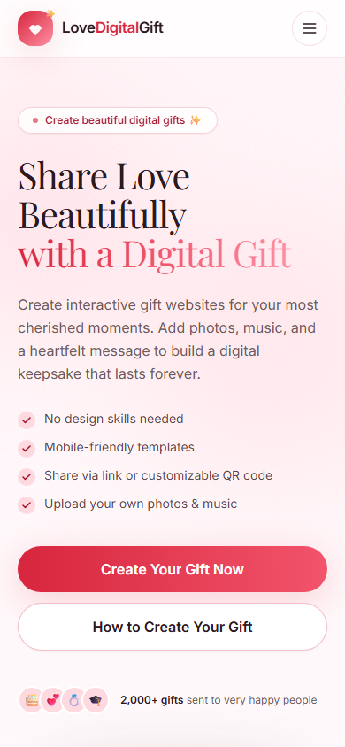
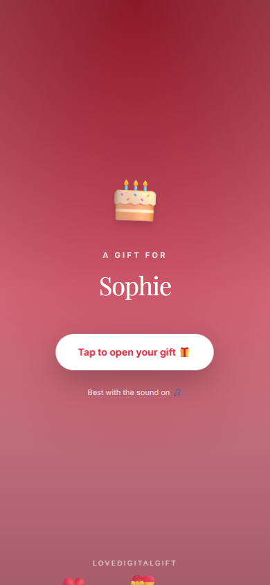
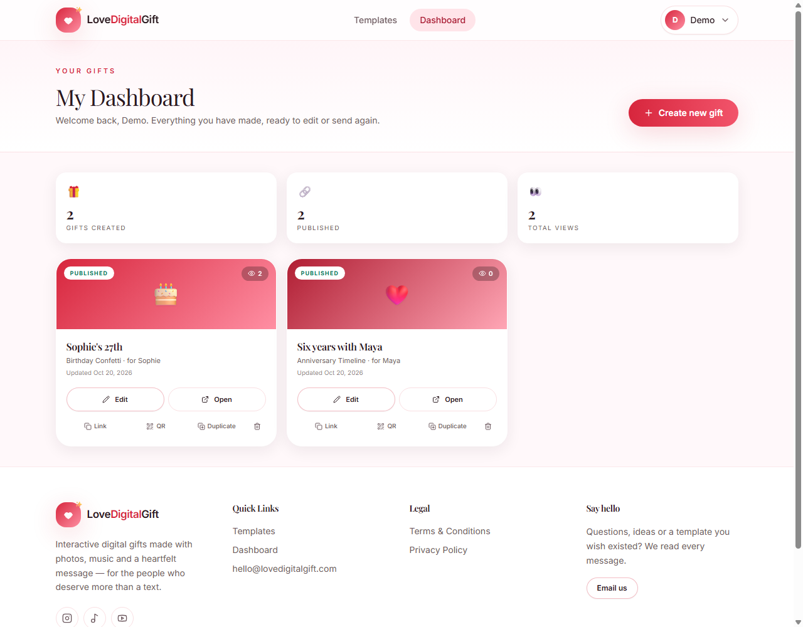
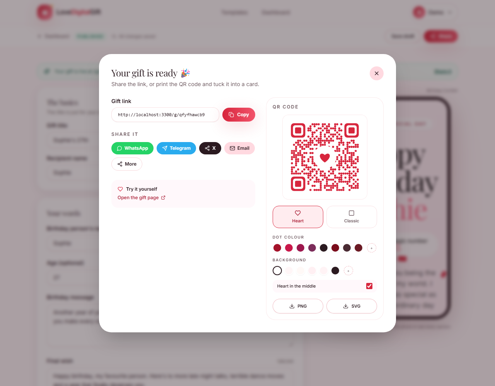

# LoveDigitalGift

An interactive digital-gift builder: pick a template, add your own words, photos and music, then share a unique link or a customisable QR code (heart or classic square). Includes a dashboard, accounts, legal pages and 28 ready-to-edit templates.

Built from the build spec in `CLAUDE_BUILD_SPEC_lovedigitalgift_clone md fie.md`.

---

## Quick start (under 10 steps)

1. Install **Node.js 20+** (developed and verified on Node 24).
2. In this folder run `npm install`.
3. Copy `.env.example` to `.env.local` and change `SESSION_SECRET` (a local `.env.local` is already included for development).
4. Run `npm run dev`.
5. Open <http://localhost:3000>.
6. Click **Create a gift**, sign up with any email and an 8+ character password.
7. Pick a template, edit the text, upload photos, choose music, hit **Publish**.
8. Copy the link or download the QR code from the share dialog.
9. Open the link in a private window to see exactly what the recipient sees.

Production: `npm run build` then `npm start`.

There is a ready-made demo account if you just want to look around:

| Email | Password |
| --- | --- |
| `demo@lovedigitalgift.com` | `demo12345` |

It owns two published gifts, so the dashboard and public gift page have real content.

---

## Screenshots

| Homepage | Template gallery |
| --- | --- |
|  |  |

| Mobile homepage | Public gift cover |
| --- | --- |
|  |  |

| Dashboard | Share dialog + QR customiser |
| --- | --- |
|  |  |

---

## Theme

Vibrant crimson with soft strawberry-pink accents, defined once in `tailwind.config.ts` and `src/app/globals.css`.

| Token | Value |
| --- | --- |
| Brand / primary buttons | `#D7263D` |
| Deep accent | `#A4122A` |
| Soft brand (chips, badges) | `#FFD9E0` |
| Strawberry gradient stops | `#FF8FA3`, `#FFB7C5`, `#FFC9D3` |
| Page background | `#FFF6F7` |
| Ink / muted text | `#2B1A20` / `#6E5A60` |

---

## What is implemented

**Homepage** — every section from the spec: sticky navbar, hero with phone mockup and four tick points, count-up stats strip, three-step "How It Works" (scroll anchor), featured templates, three testimonials, gradient final CTA with floating hearts, full footer, SEO meta + Open Graph, and a `#how-it-works` smooth-scroll target.

**Templates** — 28 templates across 11 occasion filters (Birthday, Anniversary, Wedding, Valentine, Graduation, Christmas, Friendship, Thank You, Apology, New Year, Others) built on seven distinct interactive layouts:

| Layout | What it does |
| --- | --- |
| Birthday Confetti | age reveal, balloon + confetti layer, photo carousel, "blow the candles" tap interaction, final wish |
| Anniversary Timeline | live "together for X years, Y days" counter, alternating dashed timeline built from dated memories, photo grid, letter |
| Love Letter | sealed envelope that opens on tap, typed-out letter, floating hearts, optional Yes/No question with a "No" button that dodges the cursor |
| Photo Memories | draggable polaroid stack with captions and keyboard-accessible next/previous |
| Wedding Invitation | serif invitation, live countdown, details, photo strip, RSVP line |
| Reasons Cards | grid of 3D flip cards, one reason each, closing message |
| Celebration | confetti / snow / fireworks / floating-heart effects, optional countdown, photo grid, message |

The gallery has search, occasion chips with counts, and a live preview page per template inside a phone frame. The also includes `Others` templates for Mother's Day, Father's Day, Baby Shower, Get Well Soon, Proposal and Congratulations.

**Editor** — two-column form + live phone preview (tabs on mobile), autosave with a Saved indicator, character counters, drag-and-drop photo upload with client-side compression (max 1600px, JPEG ~82%), reorder/remove/caption photos, 8-track music library plus MP3 upload with preview, accent-colour picker, Save draft / Publish, and a share dialog after publishing.

**Sharing** — unique 10-character link at `/g/[id]`, copy button, WhatsApp / Telegram / X / Email buttons, native Web Share on mobile, and a QR customiser with heart-shaped or classic-square modules, any foreground/background colour, optional centre heart, PNG and SVG download. QR settings persist per gift.

**Gift page** — public, no login. Cover screen ("Tap to open your gift 🎁") starts the music after the first tap (browser autoplay rules), then renders the personalised template with a floating mute button, a view counter and per-gift Open Graph tags.

**Dashboard** — stats, published/draft badges, view counts, open / edit / copy link / QR / duplicate / delete (with a confirmation dialog), and a friendly empty state.

**Auth** — email + password signup and login, scrypt password hashing, HTTP-only signed session cookie, `?next=` redirects, protected `/dashboard` and `/create/*` (middleware plus a server-side session check).

**Legal & SEO** — `/terms`, `/privacy`, `/robots.txt`, `/sitemap.xml`, custom 404, favicon, 1200×630 OG image.

---

## Stack

- **Next.js 15** (App Router, TypeScript, React 19)
- **Tailwind CSS** for styling, **Framer Motion** for the reveals and effects, **lucide-react** for icons
- **SQLite through Node's built-in `node:sqlite`** — no database server to install
- Local disk storage for uploads, served through `/api/media/[name]`
- A hand-written QR renderer (`src/lib/qr.ts`) with rounded "heart" dots or classic squares, a heart centre logo, and SVG/PNG export
- `zod` for request validation, `nanoid` for ids/slugs
- Self-hosted fonts via `@fontsource` (Playfair Display + Inter), so the app renders without Google Fonts access

### Deliberate differences from the original build spec

The spec asked for Supabase, `qr-code-styling` and Google OAuth. I chose equivalents that make the app **run immediately with zero external accounts**, and documented the migration path:

| Spec | This build | Why |
| --- | --- | --- |
| Supabase Auth/Postgres/Storage | `node:sqlite` + local `data/` folder + scrypt/cookie sessions | Runs offline; no keys needed. `supabase/schema.sql` contains the equivalent tables, RLS policies, trigger and `increment_views()` if you want to move. |
| `qr-code-styling` | Custom SVG QR renderer | Rounded "heart" dots with a heart centre (or classic squares), no canvas dependency, one code path for the on-screen QR and both downloads. True heart-shaped *modules* were tested and do not scan reliably, so the heart lives in the centre logo — the QR itself was decoded with jsQR to prove it works. |
| Google OAuth | Email + password only | OAuth needs your own client id/secret and a public callback URL; the UI and session layer are ready for it. |
| Supabase Storage | `/api/upload` + `/api/media` | Same-origin files, no bucket configuration. |
| Vercel deployment | Works anywhere Node runs | Serverless filesystems are ephemeral, so a hosted deploy should move the DB/storage to Supabase or a volume — see *Deployment*. |

Other assumptions, since the source site's inner pages could not be read:

- Template names, descriptions, field sets and sample copy are original content written for this build (the only observable copy was the homepage, which is reproduced).
- Pricing: the app is free; there is no checkout, as nothing on the source homepage mentioned payment.
- The 8 background tracks are synthesised locally by `scripts/make_music.py` (public-domain melodies where applicable) so no licensed audio is redistributed. Replace them with your own files in `public/music` and update `MUSIC_LIBRARY` in `src/lib/config.ts`.
- The "heart" QR uses heart-shaped data modules with square-ish finder eyes so it still scans. Error correction is set to H, and the centre heart is optional.

---

## Project structure

```
src/
  app/
    (site)/            # pages that share the navbar + footer
      page.tsx         # homepage
      templates/       # gallery + [slug] preview
      create/[slug]/   # editor (auth)
      dashboard/       # gift dashboard (auth)
      login, signup, terms, privacy
    g/[id]/            # public gift page (no site chrome)
    api/               # auth, upload, media, gifts CRUD, views
    layout.tsx         # fonts, metadata, theme colour
  components/
    home/              # hero, stats, how-it-works, testimonials, CTA
    site/              # navbar, footer, logo
    templates/         # gallery, card, live preview
    editor/            # editor, field inputs, photo uploader, music picker
    share/             # share modal + QR customiser
    dashboard/         # dashboard client
    gift/              # cover screen + audio
    auth/              # auth pages shell + form
  lib/                 # db, auth, gifts, validation, qr, config, utils
  templates/           # registry, shared primitives/effects, 7 layouts
  middleware.ts        # protects /dashboard and /create
data/                  # created at runtime: app.db + uploads/
public/                # music/, og-image.png, logo.png
scripts/               # make_music.py, make_images.py
supabase/schema.sql    # optional hosted-database schema
```

Uploads and the database live in `data/` and are gitignored. Delete that folder to reset the app; it is recreated on the next request.

---

## Environment variables

| Variable | Required | Purpose |
| --- | --- | --- |
| `NEXT_PUBLIC_SITE_URL` | recommended | Public origin used for canonical links and OG tags (defaults to `http://localhost:3000`). |
| `SESSION_SECRET` | recommended | HMAC key for session cookies. Change before deploying. |
| `DATA_DIR` | optional | Where `app.db` and `uploads/` live. Defaults to `./data`. |
| `NEXT_PUBLIC_CONTACT_EMAIL` | optional | Footer contact address. |
| `NEXT_PUBLIC_GOOGLE_*` | not used | Reserved for adding Google OAuth. |

---

## Adding a template

1. Create `src/templates/my-template.tsx` — a `"use client"` component with the signature `({ content, accent }: TemplateRenderProps)`.
2. Reuse `Stage`, `Reveal`, `Photo`, `PhotoCarousel`, `Countdown`, `FlipCard` and the effects from `src/templates/shared/`.
3. In `src/templates/registry.ts`, add an entry with `fields` (text / textarea / date / color / images / list), `defaultContent`, a gradient and an accent colour. The editor builds itself from `fields`.
4. That's it — the gallery, preview page and editor pick it up automatically.

If your template needs an internal setting (like the celebration effect), add it to `defaultContent`; it will be saved with the gift and is not shown in the editor.

---

## Deployment

The app is a standard Next.js project: `npm ci && npm run build && npm start` behind any Node host or reverse proxy.

Two things to move before a public launch:

1. **Database & uploads.** Serverless hosts (Vercel) have an ephemeral filesystem. Point `src/lib/db.ts` and `src/routes/api/upload` at Supabase (or Postgres + S3) — `supabase/schema.sql` is the starting point. A small VPS with a persistent volume also works as-is.
2. **Branding.** Replace the name, logo, social links, testimonials and legal text. The spec's own note says the copy and structure follow the original site and should be replaced before launch.

---

## Verification performed

- `npx tsc --noEmit` — clean.
- `npm run build` — production build succeeds; all routes compile and page data is collected.
- End-to-end flow exercised against the production server: signup → create draft → upload image → publish → open `/g/[id]` without a session → view counter increments → duplicate/delete → dashboard listing. `node scripts/verify.mjs` runs 34 checks, all passing.
- QR codes decoded from the rendered share dialog with `jsQR`: classic and heart styles both resolve to the exact gift URL.
- Homepage checked at 390/768/1280 widths, plus `/templates`, a template preview, the editor, the dashboard, the gift page, login and both legal pages.

---

## Credits & disclaimer

The homepage copy and section order follow <https://lovedigitalgift.com/> as recorded in the build spec. The name, logo and testimonials are placeholders; replace them with your own before launching. Music is generated locally, not sampled from commercial recordings.
